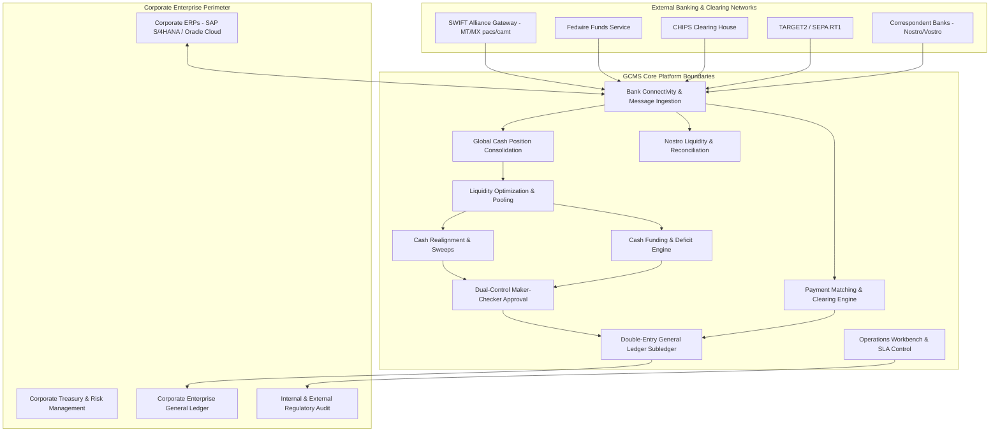
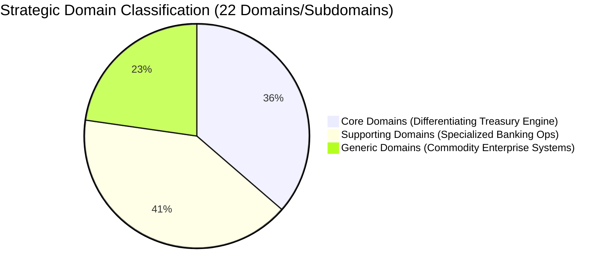
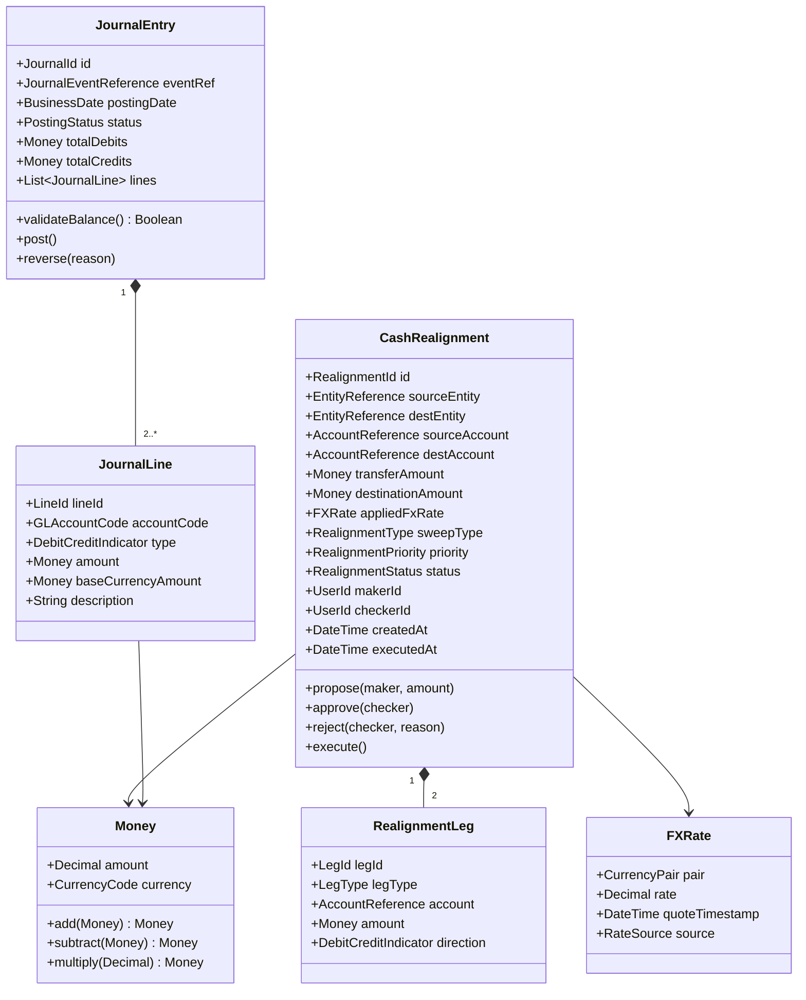
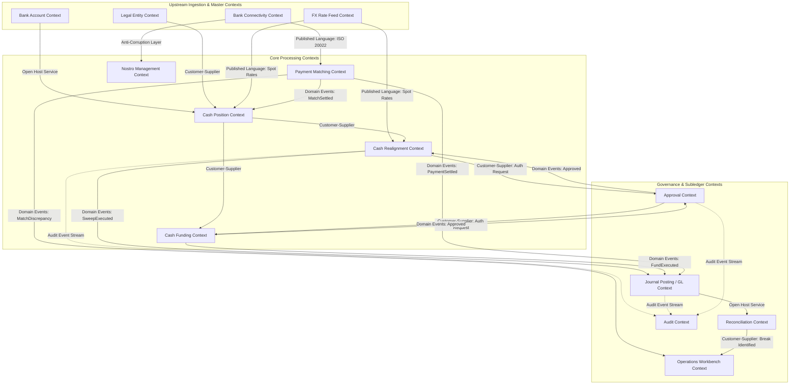
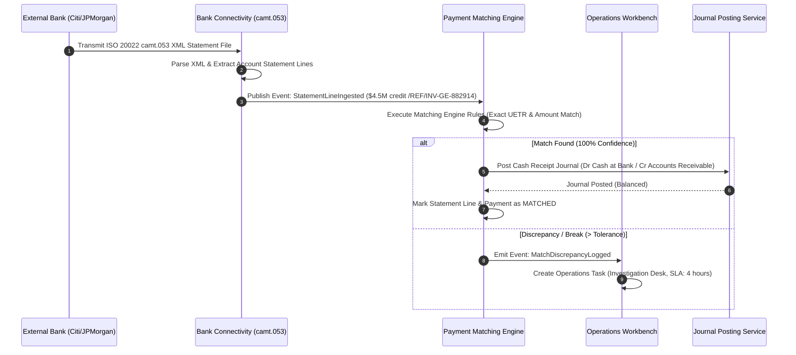
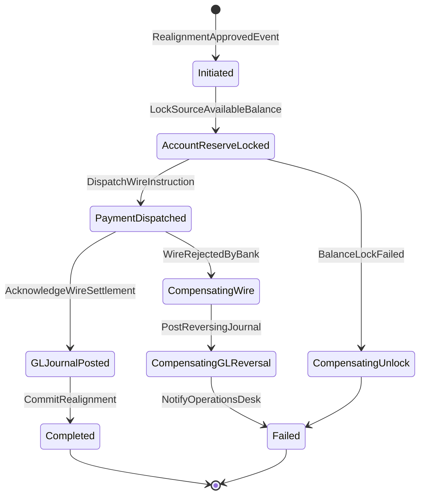
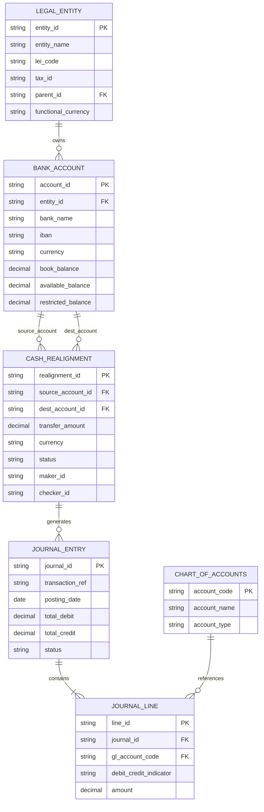
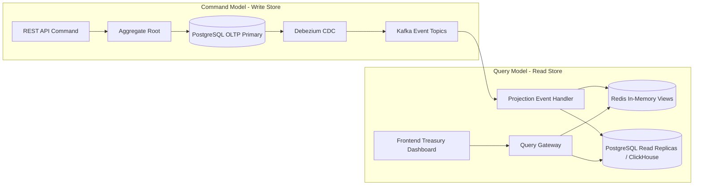
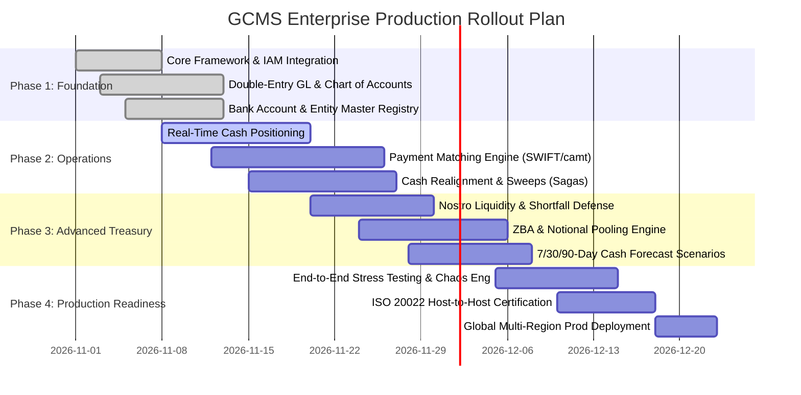

# GLOBAL CASH MANAGEMENT SYSTEM (GCMS)
## Enterprise Domain-Driven Design (DDD), Business Architecture & Microservices Blueprint

---

### Executive Summary & Metadata
- **System**: Global Cash Management System (GCMS)
- **Role Target**: Principal Enterprise Architect, DDD Architect, Banking Domain Expert, Treasury Architect
- **Target Organization Scope**: Tier-1 Global Transaction Banking (Citi, Wells Fargo, Bank of America) & Multinational Corporate Treasury (Fortune 50)
- **Architectural Paradigms**: Strategic & Tactical DDD, Event-Driven Architecture (EDA), CQRS, Database-per-Service, Strict Double-Entry Accounting, Distributed Sagas with Reversing Compensations, ISO 20022 Compliance, Maker-Checker Governance.
- **Specification Version**: 3.0.0-PROD

---

# DELIVERABLE 1: Business Context & Business Capability Model

## 1.1 Business Context Definition
GCMS is the mission-critical core platform responsible for centralizing, managing, optimizing, forecasting, and accounting for cash and liquidity across a global corporate network of legal entities, multi-currency bank accounts, correspondent banks, payment clearing networks, and corporate general ledgers.



## 1.2 Comprehensive Business Actors & Permissions Matrix

| # | Actor Name | Business Role | Core Responsibilities | Permissions & Scopes | Approval Limit | Key Context Interactions |
|---|------------|---------------|-----------------------|----------------------|----------------|--------------------------|
| 1 | **Global Treasury Manager** | Head of Global Treasury | Global liquidity strategy, group capital allocation, regulatory buffer oversight | `treasury:global:read`, `treasury:policy:write`, `approval:tier4:sign` | Up to $100M | Cash Position, Free Cash, Liquidity Optimization, Approval Context |
| 2 | **Regional Treasury Manager** | Regional Treasury Lead (Americas, EMEA, APAC) | Regional cash concentration, intercompany loan sweeps, local regulatory capital compliance | `treasury:regional:read`, `treasury:regional:write`, `approval:tier3:sign` | Up to $50M | Cash Realignment, Cash Funding, Liquidity Limits Context |
| 3 | **Cash Manager (Maker)** | Liquidity Operations Lead | Daily cash positioning, cash mobilization proposal creation, target balancing | `cash:position:read`, `cash:realign:propose`, `cash:fund:request` | $0 (Maker only) | Cash Position, Cash Realignment, Cash Flow Context |
| 4 | **Liquidity Manager** | Liquidity Optimization Specialist | ZBA pooling rules, notional pooling structure maintenance, yield maximization | `liquidity:pool:manage`, `liquidity:optimization:execute` | Up to $25M | Cash Pooling, Liquidity Optimization Context |
| 5 | **Cash Funding Operator** | Funding Desk Specialist | Operating account deficit identification, overnight credit line drawdowns | `cash:fund:create`, `cash:fund:modify` | $0 (Maker only) | Cash Funding, Nostro Liquidity Context |
| 6 | **Cash Realignment Operator** | Sweep Execution Desk | Manual sweep proposal execution, spot FX conversion booking | `cash:realign:create`, `fx:convert:quote` | $0 (Maker only) | Cash Realignment, FX Conversion Context |
| 7 | **Payment Operations Analyst** | Settlement Desk Analyst | SWIFT pacs.008 instruction verification, Fedwire payment release | `payment:instruction:create`, `payment:status:read` | Up to $1M | Payment Instruction, Payment Processing Context |
| 8 | **Reconciliation Analyst** | Bank Recon Specialist | camt.053 vs internal ledger comparison, variance investigation | `recon:match:manual`, `recon:break:investigate` | N/A | Reconciliation, Bank Statement Ingestion Context |
| 9 | **Nostro Operations Analyst** | Correspondent Banking Analyst | Nostro account balance tracking, overdraft prevention, daylight exposure | `nostro:monitor`, `nostro:fund:propose` | Up to $10M | Nostro Account, Nostro Liquidity Context |
| 10 | **Accounting Officer (Maker)** | Subledger Accountant | Fee/interest adjustments, accrual bookings, intercompany settlement entries | `gl:journal:create`, `gl:adjustment:create` | $0 (Maker only) | Journal Posting, Cash Adjustment Context |
| 11 | **Financial Controller (Checker)**| Financial Controller | Period closing sign-off, GL journal authorization, trial balance verification | `gl:journal:post`, `gl:period:close`, `approval:tier3:sign` | Up to $50M | General Ledger, Chart of Accounts, Approval Context |
| 12 | **Operations Supervisor** | Middle-Office Supervisor | Task assignment, SLA breach resolution, queue management | `ops:task:assign`, `ops:sla:override` | N/A | Operations Workbench, SLA Context |
| 13 | **Risk Manager** | Treasury Risk & Basel III Officer | LCR/NSFR monitoring, counterparty credit limit surveillance | `risk:limits:configure`, `risk:monitor:global` | N/A | Liquidity Limits, Currency Exposure Context |
| 14 | **Compliance Officer** | AML / Sanctions Officer | Sanctions escalation review, suspicious transaction hold | `compliance:hold`, `compliance:release` | N/A | Payment Processing, Exception Context |
| 15 | **Business Administrator** | System Configuration Specialist | Entity calendar configuration, bank identifier codes, routing tables | `config:business:write`, `refdata:manage` | N/A | Business Configuration, Reference Data Context |
| 16 | **System Administrator** | Platform Reliability Lead | Microservice health monitoring, Kafka consumer lag observation | `sys:health:read`, `sys:config:write` | N/A | Identity, Audit Context |
| 17 | **Auditor (Internal / External)** | Regulatory / SOX Auditor | Read-only tamper-evident audit trail inspection, provenance tracing | `audit:read`, `report:export` | Read-only | Audit Context, Reporting & Analytics Context |
| 18 | **External Bank** | Depository Financial Institution | Ingests MT940 / camt.053 statements, receives pacs.008 wires | Host-to-Host mTLS / AS2 | N/A | Bank Connectivity Context |
| 19 | **Correspondent Bank** | Clearing Bank Partner | Holds Nostro clearing accounts, provides intraday debit/credit notifications | SWIFT Alliance FIN / InterAct | N/A | Nostro Management, Bank Connectivity Context |
| 20 | **Corporate ERP System** | Enterprise Resource Planning (SAP) | Dispatches AP payment batches, receives AR cash application feeds | REST / Kafka Connector / IDoc | Automated | Cash Flow Ingestion, Payment Instruction Context |
| 21 | **Enterprise GL System** | Corporate Core GL (SAP FI/CO) | Receives summary consolidated balanced trial balance journals | REST / SFTP Batch Journal API | Automated | General Ledger Context |

---

# DELIVERABLE 2: Domain Landscape & Strategic DDD Classification

Strategic classification establishes clear investment boundaries, isolating competitive differentiators (Core) from foundational capabilities (Supporting) and standard commodities (Generic).



### Strategic Classification Matrix

| Domain | Subdomain | Classification | Business Value & Rationale | Business Owner | Technical Complexity |
|--------|-----------|----------------|----------------------------|----------------|----------------------|
| **Cash Management** | Cash Position Consolidation | **CORE** | Multi-entity, multi-currency real-time cash visibility across parent/child structures | Global Treasury | High (Streaming Aggregations) |
| **Cash Management** | Cash Realignment & Sweeping | **CORE** | Automated liquidity rebalancing, intercompany sweeps, FX auto-hedging | Global Treasury | Very High (Sagas, FX, Limits) |
| **Cash Management** | Cash Funding Deficit Engine | **CORE** | Real-time shortfall detection, automated zero-balance pool drawdowns | Treasury Ops | High (Deficit Arithmetic) |
| **Cash Management** | Free Cash & Trapped Reserves | **CORE** | Regulatory reserve segregation, idle cash yield optimization | Treasury Strategy | High (Policy Rules Engine) |
| **Liquidity Management**| Liquidity Optimization & Pools | **CORE** | ZBA, Target Balancing, Notional Pooling, interest offset optimization | Global Treasury | Very High (Complex Algorithms) |
| **Payment Management** | Real-Time Payment Matching | **CORE** | Sub-second rule-based pairing of SWIFT/Fedwire vs bank statement lines | Payments Ops | Very High (Fuzzy/Tolerance Rules) |
| **Cash Forecasting** | Cash Flow Projections (7/30/90d)| **CORE** | Predictive horizon liquidity modeling under base & stress conditions | Corporate Finance | High (Scenario Modeling) |
| **Nostro Management** | Nostro Liquidity & Exposure | **CORE** | Multilateral correspondent bank balance optimization & daylight overdraft prevention | Correspondent Banking | High (Real-time Nostro Balances) |
| **Accounting** | Double-Entry General Ledger | **SUPPORTING** | Complete double-entry balance verification ($\Delta = 0$), immutable posting, reversal workflows | Financial Control | High (Transaction Atomicity) |
| **Accounting** | Intercompany Loan Subledger | **SUPPORTING** | Tracking intercompany receivables/payables arising from sweeps | Financial Control | Medium (Double-entry Pairs) |
| **Reconciliation** | Bank Statement & Breaks | **SUPPORTING** | Multi-source ledger reconciliation, automated break aging & root-cause tracking | Operations Control | Medium (Event Ingestion) |
| **Entity Management** | Legal Entity Hierarchy | **SUPPORTING** | 3-tier parent/subsidiary tree rollups, LEI registry, tax domicile rules | Corporate Secretary | Medium (Tree Graph Traversal) |
| **Bank Account Mgmt** | Master Bank Account Registry | **SUPPORTING** | KYC metadata, IBAN/BIC validation, account limits & signers | Treasury Operations | Low/Medium (Master Data CRUD) |
| **Bank Connectivity** | ISO 20022 / SWIFT Gateway | **SUPPORTING** | Parsing & normalizing pacs.008, pacs.002, camt.052, camt.053, MT103, MT940 | Integration Architecture| High (Schema Normalization) |
| **Operations** | Operations Task Workbench | **SUPPORTING** | Middle-office task management, SLA countdown timers, investigation drawers | Operations Mgmt | Medium (Workflow Engine) |
| **Exception Mgmt** | Severity Exception Engine | **SUPPORTING** | Root-cause classification, failover routing, operational escalation | Operations Mgmt | Medium (Rules Engine) |
| **Approval & Controls**| Maker-Checker Dual Control | **SUPPORTING** | Segregation of duties, matrix approval thresholds, delegation logs | Compliance & Risk | Medium (Stateful Guardrails) |
| **Reporting** | Treasury & Analytics Catalog | **SUPPORTING** | Generation of 20+ regulatory, operational, and management reports | Treasury Analytics | Medium (Read Models / SQL) |
| **FX & Multi-Currency**| Spot FX Rates & Conversion | **SUPPORTING** | Cross-rate triangulation, direct/indirect quotation, revaluation | Treasury Desk | Medium (Arithmetic Precision) |
| **Security & IAM** | Identity & Access Management | **GENERIC** | OAuth2.0 / OIDC tokens, role-based access, JWT validation | Enterprise IT | Standard (Keycloak/Okta) |
| **Audit & Compliance** | Tamper-Evident Audit Log | **GENERIC** | Cryptographic hash chaining, append-only operational audit trails | Enterprise Risk | Standard (Kafka/Postgres Write-only) |
| **System Configuration**| Reference Data & Calendars | **GENERIC** | ISO currency codes, BIC lists, country clearing holiday calendars | Central IT | Low (Reference Tables) |

---

# DELIVERABLE 3: Complete Domain, Subdomain & Bounded Context Hierarchy

```
Global Cash Management System (GCMS)
│
├── 1. Cash Management Domain
│   ├── Subdomain: Cash Position Management      --> [ Cash Position Context ]
│   ├── Subdomain: Cash Realignment Management   --> [ Cash Realignment Context ]
│   ├── Subdomain: Cash Funding Management       --> [ Cash Funding Context ]
│   ├── Subdomain: Cash Adjustment Management    --> [ Cash Adjustment Context ]
│   ├── Subdomain: Cash Balance Projection       --> [ Cash Balance Context ]
│   └── Subdomain: Free Cash Optimization        --> [ Free Cash Context ]
│
├── 2. Liquidity Management Domain
│   ├── Subdomain: Liquidity Planning            --> [ Liquidity Planning Context ]
│   ├── Subdomain: Liquidity Optimization        --> [ Liquidity Optimization Context ]
│   ├── Subdomain: Cash Pooling (ZBA/Target)     --> [ Cash Pooling Context ]
│   └── Subdomain: Liquidity Limits Surveillance --> [ Liquidity Limits Context ]
│
├── 3. Payment Management Domain
│   ├── Subdomain: Payment Instruction           --> [ Payment Instruction Context ]
│   ├── Subdomain: Payment Processing & Routing  --> [ Payment Processing Context ]
│   ├── Subdomain: Payment Matching & Clearing   --> [ Payment Matching Context ]
│   └── Subdomain: Payment Returns & Reversals   --> [ Payment Returns Context ]
│
├── 4. Cash Flow & Forecasting Domain
│   ├── Subdomain: Cash Flow Ingestion & Normalization --> [ Cash Flow Ingestion Context ]
│   ├── Subdomain: Actual/Expected Cash Flows    --> [ Cash Flow Context ]
│   └── Subdomain: Multi-Horizon Cash Projection --> [ Cash Projection Context ]
│
├── 5. Bank Account Management Domain
│   ├── Subdomain: Bank Account Master Registry  --> [ Bank Account Context ]
│   └── Subdomain: Account Rules & Configuration --> [ Account Configuration Context ]
│
├── 6. Nostro Management Domain
│   ├── Subdomain: Nostro Account Registry       --> [ Nostro Account Context ]
│   ├── Subdomain: Nostro Liquidity & Shortfall  --> [ Nostro Liquidity Context ]
│   └── Subdomain: Nostro Reconciliation         --> [ Nostro Reconciliation Context ]
│
├── 7. Entity Management Domain
│   ├── Subdomain: Legal Entity Master Registry  --> [ Legal Entity Context ]
│   └── Subdomain: Corporate Hierarchy & Rollup  --> [ Entity Hierarchy Context ]
│
├── 8. Accounting & General Ledger Domain
│   ├── Subdomain: Accounting Events & Policies  --> [ Accounting Event Context ]
│   ├── Subdomain: Double-Entry Journal Posting  --> [ Journal Posting Context ]
│   ├── Subdomain: General Ledger Subledger      --> [ General Ledger Context ]
│   ├── Subdomain: Chart of Accounts (COA)       --> [ Chart of Accounts Context ]
│   └── Subdomain: Trial Balance & Period Close  --> [ Trial Balance Context ]
│
├── 9. FX & Multi-Currency Domain
│   ├── Subdomain: FX Rate Feeds & Triangulation --> [ FX Rate Context ]
│   └── Subdomain: Currency Conversion Engine    --> [ FX Conversion Context ]
│
├── 10. Reconciliation Domain
│   ├── Subdomain: Bank Statement Reconciliation --> [ Bank Reconciliation Context ]
│   └── Subdomain: Reconciliation Break Mgmt     --> [ Reconciliation Break Context ]
│
├── 11. Bank Connectivity & Integration Domain
│   ├── Subdomain: Channel Connectivity (AS2/SFTP/API) --> [ Bank Connectivity Context ]
│   ├── Subdomain: Bank Statement Ingestion (camt/MT)  --> [ Statement Ingestion Context ]
│   └── Subdomain: ISO 20022 XML Message Engine        --> [ Banking Message Context ]
│
├── 12. Operations & Exception Management Domain
│   ├── Subdomain: Operations Task Workbench     --> [ Operations Workbench Context ]
│   ├── Subdomain: Exception & Root-Cause Mgmt   --> [ Exception Management Context ]
│   └── Subdomain: Operational SLA Surveillance  --> [ SLA Management Context ]
│
├── 13. Approval & Dual-Control Domain
│   └── Subdomain: Maker-Checker Approval Portal --> [ Approval Management Context ]
│
├── 14. Reporting & Analytics Domain
│   ├── Subdomain: Consolidated Treasury Reports --> [ Cash Reporting Context ]
│   └── Subdomain: Executive KPI Analytics       --> [ Management Analytics Context ]
│
└── 15. Security, Configuration & Audit Domain
    ├── Subdomain: Identity & Access Management  --> [ Identity Context ]
    ├── Subdomain: Immutable Audit Logging       --> [ Audit Context ]
    └── Subdomain: Global Reference Data         --> [ Reference Data Context ]
```

---

# DELIVERABLE 4: Detailed Bounded Context Specifications

### Specification 4.1: Cash Realignment Context (Core Domain)
- **Context Name**: `CashRealignmentContext`
- **Domain / Subdomain**: Cash Management / Cash Realignment Management
- **Business Purpose**: Automated and manual calculation, proposal generation, eligibility verification, maker-checker submission, and lifecycle orchestration of intercompany and inter-account cash sweeps.
- **Business Scope**: Encompasses Child-to-Parent sweeps, Parent-to-Child injections, Cross-Border transfers, and Currency Realignment.
- **Explicitly Excluded Responsibilities**: Does NOT execute bank wires directly (delegated to `PaymentProcessingContext`); does NOT directly mutate GL balances (delegated to `JournalPostingContext`).
- **Business Owner**: Head of Global Liquidity Operations.
- **Ubiquitous Language**: *Realignment Proposal, Source Leg, Destination Leg, Sweeping Threshold, Target Minimum, Intercompany Loan Agreement, Margin Spread, Execution Cutoff*.
- **Aggregate Root**: `CashRealignment`
- **Invariants**:
  1. Transfer amount must be strictly greater than zero ($\text{Amount} > 0$).
  2. Source account available balance must exceed requested amount plus minimum operational buffer.
  3. Source and destination accounts cannot be identical.
  4. Maker cannot act as Checker (Segregation of Duties).
  5. Once status is `COMPLETED`, the aggregate is immutable; adjustments must be executed via compensating realignment.
- **Database Ownership**: Logical database `gcms_cash_realignment_db` (owned exclusively by `cash-realignment-service`).

### Specification 4.2: Payment Matching Context (Core Domain)
- **Context Name**: `PaymentMatchingContext`
- **Domain / Subdomain**: Payment Management / Payment Matching & Clearing
- **Business Purpose**: Real-time algorithmic and manual pairing of internal payment instructions (SWIFT pacs.008, Fedwire, ERP AP) against ingested bank statement lines (camt.053, MT940).
- **Business Scope**: Rule-based matching engine, confidence score calculation, multi-currency tolerance handling (date $\pm 2$ days, amount $\pm 0.05\%$), split-payment allocation, and side-by-side matching workbench.
- **Explicitly Excluded Responsibilities**: Does NOT ingest raw bank files (owned by `StatementIngestionContext`); does NOT post journal entries directly.
- **Business Owner**: Head of Global Payments Settlement.
- **Ubiquitous Language**: *Payment Instruction, Statement Line, Match Pair, Confidence Score, UETR, Matching Rule, Exact Match, Tolerance Match, Unlink Match, Break Escalation*.
- **Aggregate Root**: `PaymentMatchGroup`
- **Invariants**:
  1. A statement line can be matched to at most one payment instruction unless explicitly configured as a Split/Partial match.
  2. Matched amount difference cannot exceed configured system currency tolerance ($0.00$ for exact, up to limit for tolerance).
  3. Manual unlinking requires documented reason code and re-emits `PaymentUnmatchedEvent`.
- **Database Ownership**: Logical database `gcms_payment_matching_db`.

### Specification 4.3: Double-Entry General Ledger Context (Supporting Domain)
- **Context Name**: `GeneralLedgerContext`
- **Domain / Subdomain**: Accounting & General Ledger / Double-Entry Journal Posting
- **Business Purpose**: Authoritative, mathematically balanced subledger for all cash-related financial transactions, ensuring zero float drift and complete balance integrity.
- **Business Scope**: Validation of debit/credit equilibrium ($\sum \text{Debits} \equiv \sum \text{Credits}$), posting status lifecycle, Chart of Accounts resolution, and multi-currency Trial Balance generation.
- **Explicitly Excluded Responsibilities**: Does NOT initiate operational business realignments or payments.
- **Business Owner**: Chief Accounting Officer / Corporate Controller.
- **Ubiquitous Language**: *Journal Entry, Journal Line, Chart of Accounts, Debit, Credit, Accounting Period, Trial Balance, Posting Date, Reversal Entry, Out-of-Balance Error*.
- **Aggregate Root**: `JournalEntry`
- **Invariants**:
  1. $\sum \text{Line.DebitAmount} - \sum \text{Line.CreditAmount} = 0.00$ in transaction currency.
  2. $\sum \text{Line.DebitBaseAmount} - \sum \text{Line.CreditBaseAmount} = 0.00$ in ledger base currency.
  3. Posting to a `CLOSED` accounting period is strictly forbidden.
  4. Posted journals cannot be updated or deleted; corrections require an explicit reversing journal (`REVERSED` status).
- **Database Ownership**: Logical database `gcms_general_ledger_db`.

---

# DELIVERABLE 5: Microservice Catalog & Ownership Matrix

Each microservice adheres to the **Database-per-Service** pattern. Cross-service communication occurs via REST Open Host APIs for synchronous queries and Apache Kafka for asynchronous domain events.

| Microservice Name | Bounded Context | Database Owned | Commands Accepted | Events Published | Events Consumed | External / Internal Dependencies |
|-------------------|-----------------|----------------|-------------------|------------------|-----------------|-----------------------------------|
| `cash-position-service` | `CashPositionContext` | `gcms_cash_pos_db` | `RecomputeCashPosition` | `CashPositionCalculated` | `PaymentSettled`, `RealignmentExecuted`, `StatementLineIngested` | Redis (Cache), Kafka |
| `cash-realignment-service` | `CashRealignmentContext` | `gcms_realignment_db` | `ProposeRealignment`, `CancelRealignment`, `ExecuteRealignment` | `CashRealignmentProposed`, `CashRealignmentExecuted` | `ApprovalGranted`, `ApprovalRejected`, `PaymentSettled` | `approval-service`, `fx-conversion-service`, Kafka |
| `cash-funding-service` | `CashFundingContext` | `gcms_funding_db` | `CreateFundingRequest`, `ExecuteFundingSweep` | `CashFundingRequested`, `CashFundingExecuted` | `ApprovalGranted`, `CashPositionCalculated` | `cash-position-service`, `approval-service` |
| `free-cash-service` | `FreeCashContext` | `gcms_free_cash_db` | `EvaluateFreeCash` | `FreeCashCalculated`, `SurplusSwept` | `CashPositionCalculated` | `cash-position-service`, `reference-data-service` |
| `liquidity-pool-service` | `CashPoolingContext` | `gcms_pooling_db` | `TriggerPoolSweep`, `UpdatePoolRules` | `PoolSweepInitiated`, `PoolBalancesUpdated` | `CashPositionCalculated` | `cash-realignment-service`, Kafka |
| `payment-matching-service` | `PaymentMatchingContext` | `gcms_payment_match_db` | `RunAutoMatchEngine`, `PairManualMatch`, `UnpairMatch` | `PaymentMatched`, `PaymentUnlinked`, `MatchDiscrepancyLogged` | `StatementLineIngested`, `PaymentInstructionCreated` | Kafka, PostgreSQL |
| `payment-processing-service`| `PaymentProcessingContext`| `gcms_payment_proc_db` | `SubmitPaymentBatch`, `CancelPayment` | `PaymentSubmitted`, `PaymentSettled`, `PaymentFailed` | `CashRealignmentExecuted`, `CashFundingExecuted` | SWIFT Gateway, Fedwire Host |
| `nostro-management-service` | `NostroManagementContext` | `gcms_nostro_db` | `RebalanceNostro`, `LogNostroVariance` | `NostroBalanceUpdated`, `NostroShortfallDetected` | `StatementLineIngested`, `PaymentSettled` | `bank-account-service`, Kafka |
| `bank-account-service` | `BankAccountContext` | `gcms_bank_account_db` | `RegisterBankAccount`, `UpdateAccountLimits` | `BankAccountCreated`, `AccountStatusChanged` | None | PostgreSQL, Redis |
| `legal-entity-service` | `LegalEntityContext` | `gcms_entity_db` | `CreateEntity`, `UpdateParentHierarchy` | `LegalEntityCreated`, `HierarchyUpdated` | None | PostgreSQL (Hierarchical Graph) |
| `journal-posting-service` | `JournalPostingContext` | `gcms_gl_subledger_db` | `PostJournalEntry`, `ReverseJournalEntry` | `JournalPosted`, `JournalReversed`, `TrialBalanceUpdated` | `CashRealignmentExecuted`, `AdjustmentPosted`, `PaymentSettled` | PostgreSQL (ACID Serializable) |
| `fx-conversion-service` | `FXConversionContext` | `gcms_fx_rate_db` | `TickRates`, `CalculateFXCross` | `FXRateUpdated`, `RevaluationCompleted` | None | Bloomberg / Reuters Rate Feed |
| `reconciliation-service` | `BankReconciliationContext`| `gcms_recon_db` | `InitiateReconciliation`, `ResolveBreak` | `ReconBreakIdentified`, `ReconBreakResolved` | `StatementLineIngested`, `JournalPosted` | Kafka, PostgreSQL |
| `bank-connectivity-service` | `BankConnectivityContext` | `gcms_connectivity_db`| `InjectBankingMessage`, `PollStatements` | `BankingMessageReceived`, `StatementLineIngested` | None | External SWIFT Alliance / SFTP |
| `operations-task-service` | `OperationsWorkbenchContext`| `gcms_ops_task_db` | `AssignTask`, `EscalateTask`, `ResolveTask`| `TaskAssigned`, `TaskResolved`, `SLABreached` | `ReconBreakIdentified`, `PaymentUnmatched` | Redis, WebSocket |
| `approval-service` | `ApprovalManagementContext`| `gcms_approval_db` | `SubmitForApproval`, `Approve`, `Reject` | `ApprovalGranted`, `ApprovalRejected` | `CashRealignmentProposed`, `CashFundingRequested` | PostgreSQL |
| `audit-service` | `AuditContext` | `gcms_audit_db` | `AppendAuditRecord` | `AuditLogged` | All Domain Events (`#`) | Kafka Consumer (Append-Only) |

---

# DELIVERABLE 6: Tactical DDD — Aggregates, Entities, Value Objects & Invariants



## 6.1 Aggregate Specification: `CashRealignment`
- **Aggregate Root**: `CashRealignment`
- **Internal Entities**: `RealignmentLeg` (Source Debit Leg, Destination Credit Leg), `ApprovalAuditReference`.
- **Value Objects**:
  - `Money` (Immutable; strict `BigDecimal` scaling 4, currency `ISO 4217`).
  - `FXRate` (Pair `USD/EUR`, rate, bid, ask, effective timestamp).
  - `AccountReference` (Account ID, IBAN, Bank BIC).
  - `EntityReference` (LEI, Entity Code, Tax ID).
  - `RealignmentPriority` (`CRITICAL`, `HIGH`, `MEDIUM`, `LOW`).
  - `RealignmentStatus` (`PROPOSED`, `PENDING_APPROVAL`, `APPROVED`, `EXECUTED`, `REJECTED`, `FAILED`).
- **Domain Services**:
  - `RealignmentEligibilityService`: Validates sweep limits against intercompany liquidity agreements.
  - `CrossCurrencySettlementService`: Calculates target currency credit and spread margin.
- **Invariants**:
  1. `sourceAccount.currency !== destAccount.currency` requires valid `appliedFxRate`.
  2. Maker and Checker IDs must be strictly distinct: `this.makerId !== checkerId`.
  3. Execution command rejected if status is not `APPROVED`.

## 6.2 Aggregate Specification: `PaymentMatchGroup`
- **Aggregate Root**: `PaymentMatchGroup`
- **Internal Entities**: `MatchedInstructionLine`, `MatchedStatementLine`.
- **Value Objects**:
  - `UETR` (UUID v4 SWIFT End-to-End Tracking Reference).
  - `MatchConfidence` (`EXACT_100`, `TOLERANCE_95`, `MANUAL_OVERRIDE`).
  - `AmountTolerance` (Maximum allowable delta in base currency).
- **Invariants**:
  1. Once bound in status `MATCHED`, both instruction and statement line cannot participate in another match group.
  2. Unlink action can only be invoked by users with `reconciliation:override` privilege.

## 6.3 Value Object Standards: Financial Arithmetic Rules
Financial calculations MUST NEVER use native 64-bit binary floating-point (`number` / `double`).
1. **Precision**: Standard currencies (USD, EUR, GBP) maintained at scale 2; high-precision currencies (BHD, KWD) at scale 3; zero-decimal currencies (JPY, KRW) at scale 0. Intermediate rate computations scale to 8 decimals.
2. **Rounding Mode**: `HALF_EVEN` (Banker's Rounding) for all balance computations and interest accruals to eliminate systemic rounding drift across millions of daily journal legs.

---

# DELIVERABLE 7: DDD Context Map & Service Dependency Graph

The Context Map details upstream/downstream boundaries, integration patterns (ACL, OHS, PL, Customer-Supplier), and authoritative data ownership.



### Integration Patterns Explained:
1. **Bank Connectivity $\rightarrow$ Payment Matching**: *Published Language (PL)*. Normalizes external proprietary formats (BAI2, MT940, MT103) into standard ISO 20022 schemas (`pacs.008.001.10`, `camt.053.001.10`).
2. **Cash Realignment $\rightarrow$ Approval Management**: *Customer-Supplier (C/S)*. `CashRealignment` submits payload and awaits callback/event from `ApprovalManagement`.
3. **Core Services $\rightarrow$ General Ledger Subledger**: *Anti-Corruption Layer (ACL)*. Ensures banking operational events are translated into standard debit/credit accounting entries without leaking treasury sweeping jargon into General Ledger aggregates.

---

# DELIVERABLE 8: Domain Event Catalog & Integration Contracts

All domain events are emitted using **CloudEvents v1.0.2** specification and published to Apache Kafka with strict partitioning by `AggregateId` (or `AccountId`).

```json
{
  "specversion": "1.0",
  "id": "evt_99f2b8a1-4402-48df-9b22-882910ba7744",
  "source": "/services/cash-realignment-service",
  "type": "com.gcms.treasury.realignment.executed.v1",
  "datacontenttype": "application/json",
  "time": "2026-11-05T07:35:00.000Z",
  "subject": "REALIGN-2026-104",
  "correlationid": "corr_39201948-bb02-4112-a199",
  "causationid": "cmd_88291038-ff22-4911-c882",
  "data": {
    "realignmentId": "REALIGN-2026-104",
    "realignmentType": "CURRENCY_REALIGNMENT",
    "sourceEntityId": "SGP-OPS",
    "destinationEntityId": "GTHC-HQ",
    "sourceAccountId": "acc-sgp-01",
    "destinationAccountId": "acc-us-01",
    "sourceCurrency": "SGD",
    "destinationCurrency": "USD",
    "sourceAmount": 6605000.00,
    "destinationAmount": 5000000.00,
    "appliedExchangeRate": 0.756999,
    "makerId": "usr-dvance-maker",
    "checkerId": "usr-sjenkins-checker",
    "businessDate": "2026-11-05",
    "glJournalPosted": true,
    "journalEntryId": "JE-2026-11-0005"
  }
}
```

### Complete Event Catalog Matrix

| Event Name | Version | Producer Microservice | Primary Consumer Microservices | Kafka Topic | Partition Key | Idempotency Key Strategy |
|------------|---------|-----------------------|--------------------------------|-------------|---------------|--------------------------|
| `CashPositionCalculated` | v1 | `cash-position-service` | `free-cash-service`, `reporting-service` | `gcms.cash.position.v1` | `accountId` | `accountId:businessDate:timestamp` |
| `CashRealignmentProposed` | v1 | `cash-realignment-service` | `approval-service`, `audit-service` | `gcms.cash.realignment.v1` | `realignmentId` | `realignmentId:PROPOSED` |
| `CashRealignmentApproved` | v1 | `approval-service` | `cash-realignment-service` | `gcms.approval.lifecycle.v1` | `requestId` | `requestId:APPROVED` |
| `CashRealignmentExecuted` | v1 | `cash-realignment-service` | `journal-posting-service`, `cash-position-service` | `gcms.cash.realignment.v1` | `realignmentId` | `realignmentId:EXECUTED` |
| `CashFundingRequested` | v1 | `cash-funding-service` | `approval-service`, `ops-task-service` | `gcms.cash.funding.v1` | `fundingId` | `fundingId:REQUESTED` |
| `CashFundingExecuted` | v1 | `cash-funding-service` | `journal-posting-service`, `cash-position-service` | `gcms.cash.funding.v1` | `fundingId` | `fundingId:EXECUTED` |
| `PaymentInstructionCreated`| v1 | `payment-instruction-service`| `payment-matching-service`, `payment-processing-service`| `gcms.payment.instruction.v1`| `instructionId`| `uetr` |
| `PaymentMatched` | v1 | `payment-matching-service` | `journal-posting-service`, `reconciliation-service` | `gcms.payment.matching.v1` | `matchId` | `paymentId:statementLineId` |
| `StatementLineIngested` | v1 | `bank-connectivity-service` | `payment-matching-service`, `nostro-management-service` | `gcms.bank.statement.v1` | `statementLineId` | `iban:accountServicerRef:valDate` |
| `NostroShortfallDetected` | v1 | `nostro-management-service`| `cash-funding-service`, `ops-task-service` | `gcms.nostro.alerts.v1` | `nostroAccountId` | `nostroAccountId:businessDate` |
| `JournalPosted` | v1 | `journal-posting-service` | `general-ledger-service`, `reconciliation-service` | `gcms.accounting.journal.v1` | `journalId` | `journalEntryNumber` |
| `OperationsTaskEscalated` | v1 | `operations-task-service` | `notification-service`, `management-analytics-service` | `gcms.ops.tasks.v1` | `taskId` | `taskId:ESCALATED:slaTimestamp`|

---

# DELIVERABLE 9: Cross-Domain End-to-End Business Workflows

### Workflow A: Automated Cross-Border Cash Sweep & Realignment
```mermaid
sequenceDiagram
    autonumber
    participant Pos as Cash Position Service
    participant Opt as Liquidity Optimization
    participant Realign as Cash Realignment Service
    participant Appr as Approval Service (Checker)
    participant Pay as Payment Processing Service
    participant GL as Journal Posting Service
    participant Audit as Audit Service

    Pos->>Opt: Stream CashPositionCalculated (Surplus > $10M detected in US Lockbox)
    Opt->>Realign: Generate Realignment Proposal (US Lockbox -> GTHC Master Pool)
    Realign->>Appr: Submit Proposal REALIGN-2026-101 (Maker: David Vance)
    Note over Appr: Checker Sarah Jenkins logs in<br/>Validates amount, entity & cutoff
    Appr->>Realign: Dispatch Event: CashRealignmentApproved
    Realign->>Pay: Dispatch Payment Instruction (Fedwire Book Transfer)
    Pay-->>Realign: Acknowledge Settlement (UETR-CONFIRMED)
    Realign->>GL: Post Double-Entry Journal (Dr 1001 Concentration / Cr 1002 Lockbox)
    GL-->>Realign: Journal JE-2026-11-0001 Committed (Debits === Credits)
    Realign->>Pos: Trigger Balance Adjustment (+/- $10M)
    Realign->>Audit: Append Tamper-Evident Execution Record
```

### Workflow B: Incoming Bank Statement Matching & General Ledger Reconciliation


---

# DELIVERABLE 10: Distributed Sagas & Compensation Transaction Design

Distributed transactions in GCMS use the **Saga Orchestrator Pattern** backed by the **Transactional Outbox**. Under banking regulations, completed financial transfers cannot be rolled back via two-phase commit; they MUST be neutralized using **compensating accounting entries** and **reversing wire transfers**.

### Saga Specification: `CashRealignmentExecutionSaga`



| Step # | Action Service | Command Executed | Success Event | Failure Condition | Compensating Action | Compensating Service |
|--------|----------------|------------------|---------------|-------------------|---------------------|----------------------|
| 1 | `cash-position-service` | `LockAccountBalance` | `BalanceHoldPlaced` | Insufficient Available Funds | `ReleaseBalanceHold` | `cash-position-service` |
| 2 | `payment-processing-service` | `DispatchPayment` | `PaymentSettled` | SWIFT NAK / Cutoff Exceeded | `ReleaseBalanceHold` | `cash-position-service` |
| 3 | `journal-posting-service` | `PostJournalEntry` | `JournalPosted` | Closed Period / Invalid Account | `InitiateCompensatingReturnWire` | `payment-processing-service` |
| 4 | `cash-position-service` | `CommitBalanceDelta`| `BalancesUpdated` | Database Timeout | `PostReversingJournalEntry` | `journal-posting-service` |

---

# DELIVERABLE 11: Database Ownership & Relational Schemas

In accordance with strict microservice design, **no database table is ever shared across microservices**.



### PostgreSQL DDL Schema Excerpts (Enforcing Auditability & Double-Entry Balance)
```sql
-- Schema for Journal Posting Subledger (journal-posting-service)
CREATE TABLE journal_entries (
    journal_id VARCHAR(64) PRIMARY KEY,
    transaction_ref VARCHAR(64) NOT NULL,
    source_module VARCHAR(32) NOT NULL,
    posting_date DATE NOT NULL,
    currency VARCHAR(3) NOT NULL,
    total_debit NUMERIC(18, 4) NOT NULL,
    total_credit NUMERIC(18, 4) NOT NULL,
    status VARCHAR(20) NOT NULL CHECK (status IN ('DRAFT', 'POSTED', 'REVERSED')),
    created_at TIMESTAMP WITH TIME ZONE DEFAULT CURRENT_TIMESTAMP,
    posted_by VARCHAR(64) NOT NULL,
    CONSTRAINT chk_balanced_journal CHECK (total_debit = total_credit)
);

CREATE TABLE journal_lines (
    line_id VARCHAR(64) PRIMARY KEY,
    journal_id VARCHAR(64) NOT NULL REFERENCES journal_entries(journal_id) ON DELETE RESTRICT,
    gl_account_code VARCHAR(32) NOT NULL,
    debit_credit VARCHAR(2) NOT NULL CHECK (debit_credit IN ('DR', 'CR')),
    amount NUMERIC(18, 4) NOT NULL CHECK (amount > 0),
    description VARCHAR(255) NOT NULL,
    entity_id VARCHAR(32) NOT NULL
);
CREATE INDEX idx_journal_lines_acc ON journal_lines(gl_account_code);
CREATE INDEX idx_journal_lines_entry ON journal_lines(journal_id);
```

---

# DELIVERABLE 12: Domain-Driven REST API & Event Contract Specifications

All REST APIs follow consistent OpenAPI 3.1 and RFC 7807 problem-details specifications under `/api/v1/*`.

### Key API Catalog

| HTTP Method | Path | Owning Microservice | Description | Idempotency Header | Authorization Required |
|-------------|------|---------------------|-------------|--------------------|------------------------|
| `GET` | `/api/v1/cash-positions/consolidated` | `cash-position-service` | Consolidated global book, available, free & restricted cash | N/A | `treasury:read` |
| `POST` | `/api/v1/cash-realignments` | `cash-realignment-service` | Submit a new multi-currency cash realignment proposal | `X-Idempotency-Key` | `cash:realign:propose` |
| `POST` | `/api/v1/cash-realignments/{id}/approve` | `cash-realignment-service` | Dual-control checker approval of proposal | `X-Idempotency-Key` | `approval:checker:sign` |
| `POST` | `/api/v1/cash-realignments/{id}/execute` | `cash-realignment-service` | Execute approved realignment & post GL journal | `X-Idempotency-Key` | `cash:realign:execute` |
| `POST` | `/api/v1/payment-matching/auto-match` | `payment-matching-service` | Execute automated algorithmic matching engine | `X-Idempotency-Key` | `payment:match:run` |
| `POST` | `/api/v1/payment-matching/pair` | `payment-matching-service` | Confirm manual pairing of instruction & statement | `X-Idempotency-Key` | `payment:match:manual` |
| `GET` | `/api/v1/accounting/trial-balance` | `journal-posting-service` | Generate multi-currency Trial Balance report | N/A | `gl:report:read` |
| `POST` | `/api/v1/accounting/journals` | `journal-posting-service` | Post immutable balanced double-entry journal | `X-Idempotency-Key` | `gl:journal:post` |

---

# DELIVERABLE 13: CQRS Architecture & Reporting Read Models



### Specialized Read Models:
1. **Global Cash Position Read Model (`Redis / ClickHouse`)**: Aggregated by Entity, Region, Bank, and Currency. Refreshes in $< 50\text{ms}$ upon receipt of `CashPositionCalculated` event.
2. **Operations Task & SLA Dashboard Read Model (`Redis Pub/Sub`)**: Real-time WebSocket pushed queue for active breaks, pending maker-checker approvals, and SLA countdowns.
3. **Multi-Currency General Ledger Trial Balance Read Model (`PostgreSQL Read Replica`)**: Pre-aggregated account balances per period enabling immediate zero-variance trial balance views.

---

# DELIVERABLE 14: Technical Architecture & Infrastructure Topology

```mermaid
graph TB
    subgraph Client_Tier [Client Presentation Tier]
        WEB[React 19 SPA + TypeScript + Tailwind CSS]
        MOBILE[Responsive Treasury Mobile Viewport]
    end

    subgraph Edge_Tier [Edge & Gateway Infrastructure]
        CDN[Cloudflare Enterprise / WAF]
        GW[Kong Enterprise / Spring Cloud Gateway]
        IAM[Keycloak OIDC / Google Workspace Identity]
    end

    subgraph Service_Mesh [Kubernetes Microservices Mesh - Spring Boot 3.3 / Java 21]
        POS[cash-position-service]
        REALIGN[cash-realignment-service]
        MATCH[payment-matching-service]
        GL[journal-posting-service]
        NOSTRO[nostro-service]
    end

    subgraph Persistence_Eventing [Persistence & Streaming Tier]
        KAFKA_CLUSTER[Confluent Kafka Enterprise (3AZ Multi-Raft)]
        POSTGRES[(PostgreSQL 16 HA Clusters - Dedicated DB per Service)]
        REDIS_CLUSTER[(Redis Enterprise In-Memory Cache)]
    end

    WEB --> CDN
    MOBILE --> CDN
    CDN --> GW
    GW --> IAM
    GW --> POS
    GW --> REALIGN
    GW --> MATCH
    GW --> GL
    GW --> NOSTRO

    POS --> KAFKA_CLUSTER
    REALIGN --> KAFKA_CLUSTER
    MATCH --> KAFKA_CLUSTER
    GL --> KAFKA_CLUSTER

    POS --> POSTGRES
    REALIGN --> POSTGRES
    MATCH --> POSTGRES
    GL --> POSTGRES
    POS --> REDIS_CLUSTER
```

---

# DELIVERABLE 15: Architecture Decision Records (ADRs)

### ADR-001: Strict Double-Entry Subledger for Cash Operations
- **Status**: ACCEPTED
- **Context**: A core defect in legacy treasury applications is the mutation of single balance fields without double-entry auditability, resulting in cash drift.
- **Decision**: All balance-affecting operations (realignments, funding, adjustments, settled payments) must post balanced journal entries ($\sum \text{Debits} \equiv \sum \text{Credits}$) through `JournalPostingContext`.
- **Consequences**: Eliminates reconciliation breaks between operations and corporate GL; enforces audit trails.

### ADR-002: Reversing Compensations Over Distributed 2PC
- **Status**: ACCEPTED
- **Context**: External banking payment networks (SWIFT, Fedwire) are asynchronous. Distributed two-phase commit (2PC) cannot lock external banking ledgers.
- **Decision**: Distributed workflows are orchestrated using the Saga pattern. Failures post explicit reversing journal entries and initiate compensating return wires.

### ADR-003: Database-per-Service Logical and Physical Isolation
- **Status**: ACCEPTED
- **Context**: Cross-service table joins create tight coupling and prevent independent microservice scaling and database upgrades.
- **Decision**: Each bounded context microservice owns its dedicated PostgreSQL database schema. Cross-service data requests are served via REST APIs or CQRS Kafka projections.

### ADR-004: Arbitrary-Precision Decimal Representation for Currency
- **Status**: ACCEPTED
- **Context**: IEEE-754 floating-point representations introduce precision errors (e.g., $0.1 + 0.2 = 0.30000000000000004$) that violate banking audit standards.
- **Decision**: All financial amounts are modeled using `BigDecimal` (scale 4, `HALF_EVEN` Banker's Rounding).

---

# DELIVERABLE 16: Implementation Roadmap & Development Sequence



---

# ARCHITECTURE QUALITY GATES VALIDATION
- [x] **Clear Bounded Contexts**: 15 domains, 22 bounded contexts, zero overlapping authoritative data ownership.
- [x] **Authoritative Accounting**: General Ledger isolated as sole mutator of subledger entries; operations services publish events rather than updating ledger tables.
- [x] **Maker-Checker Integrity**: Enforced statefully at domain aggregate level (`makerId !== checkerId`).
- [x] **No Floating Point Float Drift**: Decoupled domain value objects using `BigDecimal` and Banker's Rounding (`HALF_EVEN`).
- [x] **Decoupled Asynchronous Eventing**: CloudEvents schema versioning with transactional outbox and Kafka topics.
- [x] **Independent Microservices**: Strict database-per-service isolation with clear CQRS query projections.
